<div align="center">

# Time Tracker for Android

**One tap to track. One glance to see where your time went.**

Local-only time tracking with colored activity buttons, a live timer, a timeline calendar,
week and month insights, and a home-screen widget. No account, no server, no Internet permission.


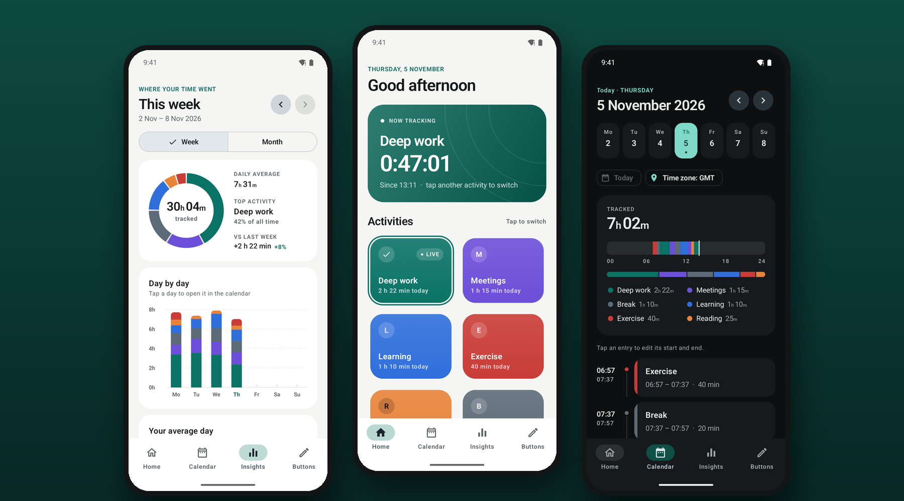

</div>

## Install on Android

Time Tracker requires Android 8.0 or newer.

1. On your phone, open the [latest GitHub release](https://github.com/simonMettler2000/android-time-tracker/releases/latest).
2. Under **Assets**, download the `.apk` file and open it from **Downloads**.
3. If Android asks for permission, tap **Settings** and turn on **Allow from this source** for the browser or file manager that opened the APK. Return to the installer and tap **Install** or **Update**. [Android installation help](https://support.google.com/pixelphone/answer/7391672#zippy=%2Cdownload-apps-from-other-sources)

The APK uses the same development signing key as the earlier download. If you already use that build, install the APK over it to keep your local tracking history. Uninstalling the app or clearing its storage deletes that history.

## Track: one tap, no timers to babysit

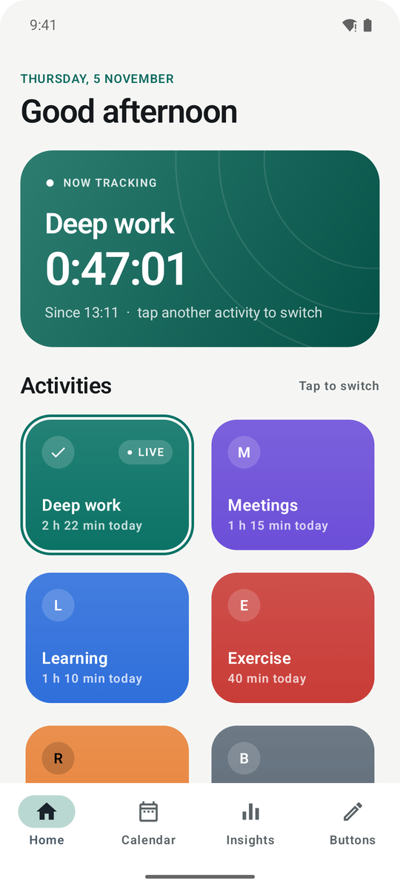

Tracking is the main job, so Home opens on it. The **Now tracking** card shows the running activity with a live stopwatch. Below it, each activity is a colored tile with today's total. Tap a tile and the previous interval closes while a new one starts, including when you tap the same activity again. Nothing runs in the background, so there is no service to keep alive.

Further down, **Tracked today** shows the day so far as one bar split by activity.

<br clear="right">

## See where your time went

<p align="center">
  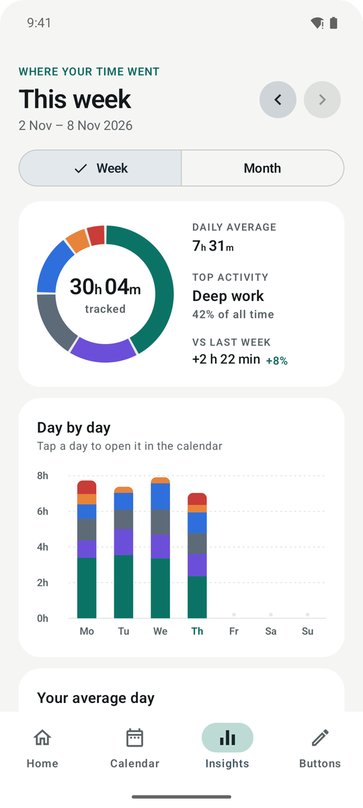
  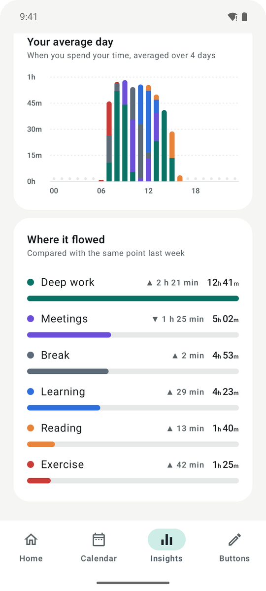
  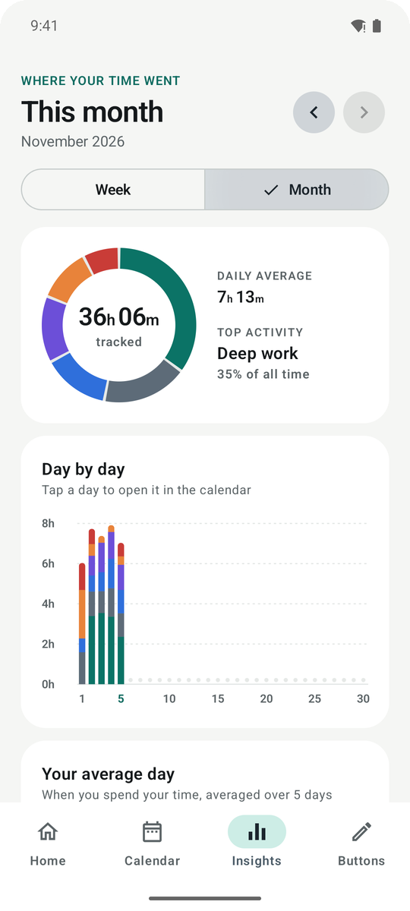
</p>

**Insights** answers the question that matters a few weeks in: where did my time go?

- **Donut** with the total, daily average, top activity and the change against last week.
- **Day by day** stacked columns for the week or month. Tap a day to open it in the calendar.
- **Your average day** shows which hours you spend on what.
- **Where it flowed** ranks activities and compares each with the same point in the previous period, so a half-finished week is never measured against a full one.

## Review and correct every entry

<p align="center">
  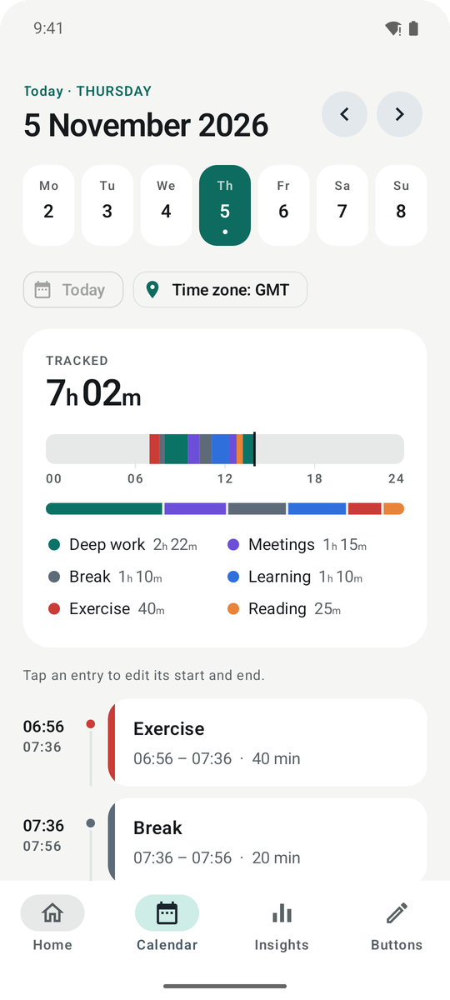
  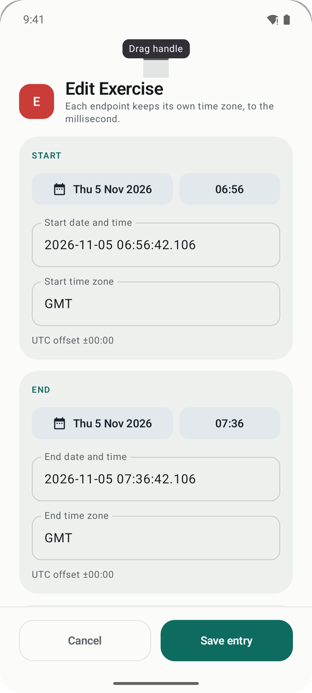
  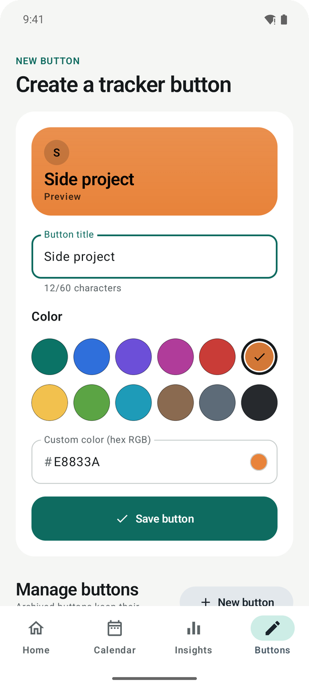
</p>

The **Calendar** has a week strip, a 24-hour ribbon that shows *when* the time happened, a per-activity breakdown and a timeline of entries. Tap an entry to adjust its start and end with date and time pickers or exact millisecond text. Each endpoint keeps its own time zone. **Buttons** lets you create, rename, recolor, reorder and archive activities, with a live preview.

## Light and dark

<p align="center">
  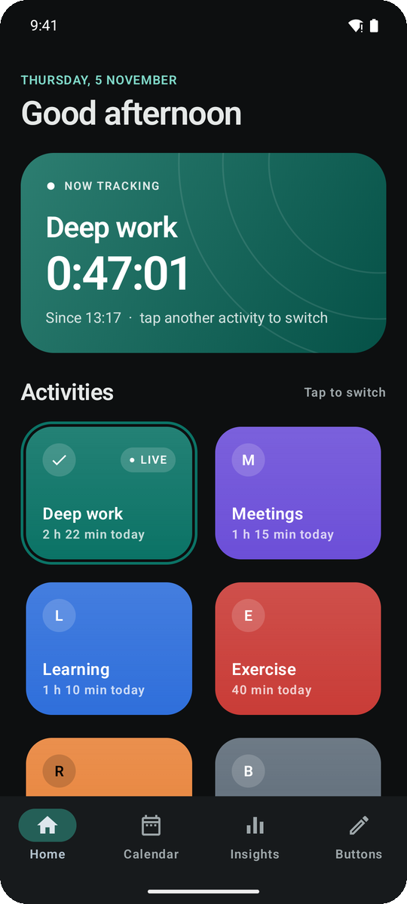
  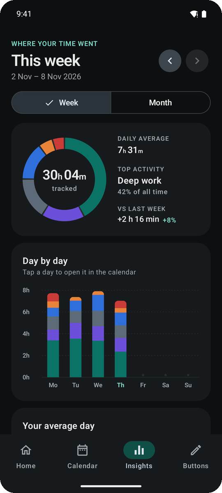
  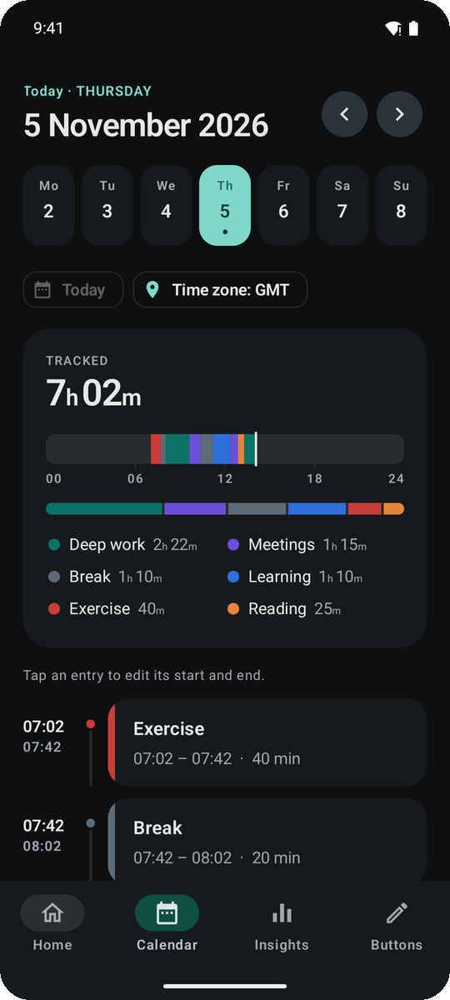
</p>

The app follows the system theme. Activity colors stay yours; the surrounding interface stays neutral, so the colors carry the meaning.

## Use the app

1. Open **Buttons**, enter a title, and pick one of twelve presets or a custom hex color.
2. Tap a tile on **Home**. The app confirms **"[title] tracker is set"** and the live timer starts.
3. Tap another tile to switch activities.
4. Open **Calendar** to browse days and tap entries to edit their endpoints.
5. Turn on **Move shared boundary** when a correction should also adjust the directly adjacent interval. Overlaps and future endpoints are rejected.
6. To stop without starting another activity, edit the active calendar entry, turn off **Keep tracking**, and save an end time.
7. Open **Insights** and switch between **Week** and **Month** to see where your time flowed.
8. In **Buttons**, archive keeps an activity's history. An active activity must be ended or switched before archiving.

To remove an accidental press, tap its entry in **Calendar** and use the trash icon. The confirmation shows which activity will get the time. Select **Include all consecutive entries** to remove repeated presses together. Time is transferred to the entry directly before the deletion when their times touch.

Each endpoint stores its UTC instant, recorded time zone, and offset. The calendar defaults to the phone's current time zone; its zone chip can pin another display zone. Repeated daylight-saving times require an explicit offset selection. The device's configured time zone must be correct; the app does not use GPS.

## Add the widget

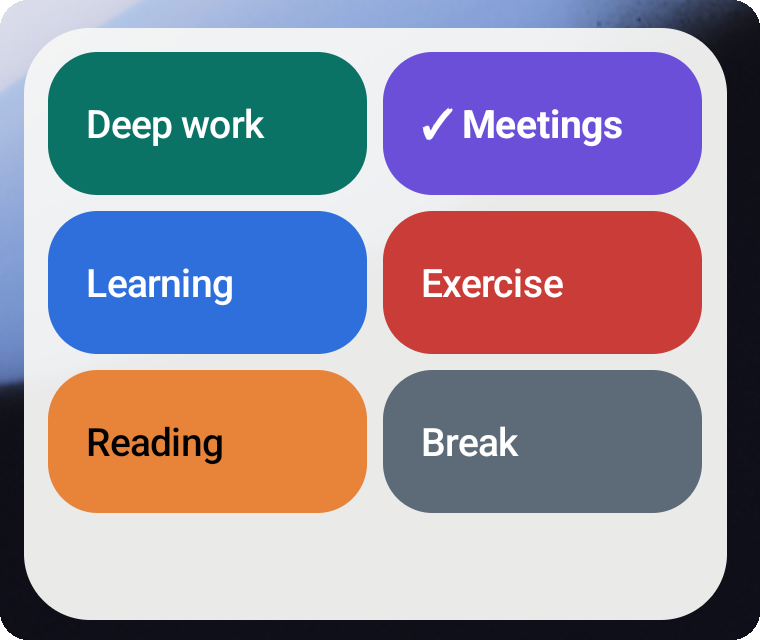

Long-press the Android home screen, open **Widgets**, find **Time Tracker**, and drag its widget onto the home screen. Resize it as needed and scroll to reach all buttons. It contains tracker buttons only. Taps save directly without opening the app; the active button gets a check mark.

Widget feedback uses Android's standard text toast and an updated active indication. Toast visibility, widget refresh timing, stopped-app behavior, and scrolling depend on Android and the launcher. Reopen the app if a launcher has stopped it or is showing a stale widget.

<br clear="right">

## Your data stays on the device

- Activity names and intervals live in the app-private `time-tracker.db` SQLite database.
- No accounts, server, analytics, ads, synchronization, or Internet permission.
- Android cloud backup and device transfer are explicitly excluded. **Uninstalling the app or clearing its storage deletes its tracking history.** There is no export/restore feature in this version.
- `.gitignore` excludes database files and SQLite sidecars, exports, device captures, local tools, signing keys, and build output. `scripts/check-public-content.py` also checks tracked paths before publication and in CI.
- Room's committed `app/schemas/` JSON describes table structure only. It contains no database rows or personal activity data.
- Tests use synthetic records in isolated databases, including a separate in-memory application database for UI/widget tests. They never open the normal tracking database.

SQLite is protected by Android's application sandbox. This app does not add database encryption. Glance/WorkManager may declare platform scheduling permissions for their short widget sessions; no app-owned recurring tracking worker or foreground tracking service is scheduled.

## Build

Install Android Studio, or JDK 21 plus the Android SDK. Install Android SDK Platform 36 and Build Tools 35.0.0, set `ANDROID_HOME`, and accept the SDK licenses. Android Studio can create the ignored `local.properties` SDK path automatically.

Windows PowerShell:

```powershell
.\gradlew.bat testDebugUnitTest lintDebug assembleDebug assembleRelease
```

macOS / Linux:

```sh
chmod +x gradlew
./gradlew testDebugUnitTest lintDebug assembleDebug assembleRelease
```

The local development APK is `app/build/outputs/apk/debug/app-debug.apk`. The GitHub release asset uses the same development signing key. The Gradle `assembleRelease` task produces an unsigned APK by default. Keep signing credentials private.

Use a disposable emulator or a dedicated test device for instrumentation. Gradle's test installer can uninstall the app. With that test device connected:

```powershell
.\gradlew.bat connectedDebugAndroidTest
```

CI is intentionally disabled. The optional definition in `ci/android.yml` runs unit tests, Android lint, debug/release builds, and SQLite/UI/widget instrumentation tests on an Android emulator. A successful build uploads the debug APK as a workflow artifact. Instrumentation screenshots contain only synthetic test activities. To enable CI, copy this file to `.github/workflows/android.yml` using a GitHub identity authorized to upload workflows.

## Project layout

| Location | Purpose |
| --- | --- |
| `app/src/main/.../data` | Room schema, DAOs, integrity triggers, and serialized transactional repository. |
| `app/src/main/.../model` | Time zones, DST validation, interval arithmetic, readable text colors, and the per-day/per-hour statistics behind Insights. |
| `app/src/main/.../ui` | Theme, Home, Calendar, Insights charts, button editor, and entry editor sheet. |
| `app/src/main/.../widget` | Two-column Glance buttons and direct tracking callback. |
| `app/src/test` | Deterministic time, interval, and statistics tests. |
| `app/src/androidTest` | Real SQLite transaction/constraint tests, Compose UI flows, and the README screenshot generator. |

## Regenerate the screenshots

The images in `docs/screenshots` come from `ReadmeScreenshots`, which seeds three weeks of synthetic activities into the isolated in-memory test database and captures each screen. Run it once in light and once in dark mode (`adb shell cmd uimode night yes|no`):

```powershell
.\gradlew.bat connectedDebugAndroidTest "-Pandroid.testInstrumentationRunnerArguments.class=com.simonmettler.timetracker.ReadmeScreenshots" "-Pandroid.testInstrumentationRunnerArguments.readme=true"
```

Gradle copies the PNGs to `app/build/outputs/connected_android_test_additional_output/`. Without the `readme` argument the class is skipped, so the normal test run stays fast.

See [ARCHITECTURE.md](ARCHITECTURE.md) and the [architecture image](architecture.png) for design details. PC/LAN support is deferred. Stable IDs and the shared repository allow a future authenticated adapter without adding network activity now.

## Validation limits

Validated on 2026-11-05: debug and unsigned release builds, Android lint (zero errors), 15 unit tests, and 17 instrumentation tests passed after the UI redesign. Device tests ran on an Android 15 / API 35 emulator. They include actual SQLite constraints and rollback, process/database recreation, calendar edits, and a real Android widget host delivering repeated PendingIntent taps. The redesigned widget was also placed on the Pixel Launcher home screen and a tap there switched the active activity. Screenshots were reviewed in light and dark mode. The earlier three-button-navigation and 130% text-size checks predate the redesign and have not been repeated.

Automated checks do not establish a measured battery saving. Physical-device idle comparisons, Android 8–14 runtime compatibility, and additional OEM launchers still require release validation. The native widget-host test requires API 29 or later; the app itself targets API 26 or later. There is no production upgrade migration yet because this is schema version 1; future versions must provide explicit migrations without deleting existing data.
